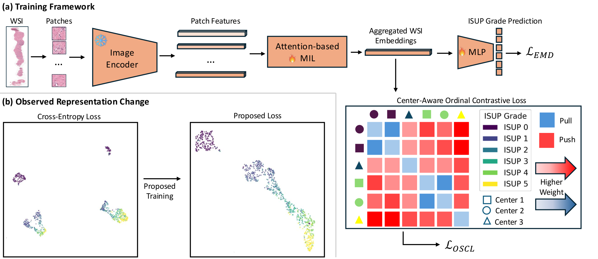
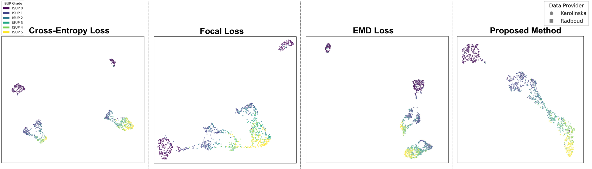
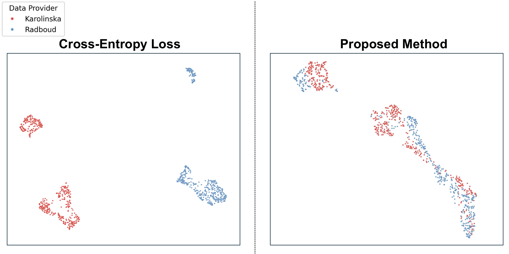

<div align="center">

<h1>Center-Aware Ordinal Learning for Prostate Cancer Grading from Histopathology Images</h1>

**Accepted to SPIE Medical Imaging 2027 (Image-Guided and Robotic Interventions)**

<p>
Mohammad Mahdi Abootorabi, Parvin Mousavi, Purang Abolmaesumi
</p>

<sub>The University of British Columbia &middot; Queen's University &middot; Vector Institute</sub>

[](#)
[](https://spie.org/MI27/conferencedetails/image-guided-and-robotic-interventions)
</div>

ISUP grades of prostate biopsies are ordered, the grade distribution is imbalanced, and slides from different centers differ in staining, tissue preparation and scanning. We aggregate frozen UNI2-h patch features with attention-based multiple instance learning (ABMIL) and train the slide representation with three objectives: a squared Earth Mover's Distance (EMD) loss that penalizes errors by their ordinal distance, a center-aware ordinal supervised contrastive loss (OSCL) that aligns same-grade slides across centers and pushes different grades apart in proportion to their grade distance, and a curriculum that gradually reduces the weight of benign slides.



On the PANDA test set the proposed model reaches an accuracy of 0.842 and a quadratic weighted kappa (QWK) of 0.958, comparable to the other loss configurations. Its main benefit is cross-center transfer: a linear probe trained on Karolinska embeddings and evaluated on Radboud improves from 0.643 to 0.823 accuracy and from 0.899 to 0.930 QWK over the cross-entropy baseline.

## Contents

```
abmil.py                  gated-attention ABMIL with projection and classification heads
train.py                  baselines: cross-entropy, focal and ordinal-CE losses
train_v3.py               proposed method: EMD + center-aware OSCL + curriculum (and its ablations)
losses.py                 EMD, ordinal supervised contrastive and combined losses (see README_losses.md)
data.py                   PANDA patch-bag dataset, collate function and loaders
extract_embeddings.py     saves slide embeddings to .npz
linear_probe.py           cross-center linear probing
plot_umap.py              UMAP plots colored by ISUP grade and by center
commands.txt              commands used for the experiments
clean_labels_with_cancer_pct.csv   cleaned PANDA slide labels
```

## Setup

```bash
git clone https://github.com/DeepRCL/ordinal-multicenter-representation-learning.git
cd ordinal-multicenter-representation-learning
conda env create -f environment.yml
conda activate his
```

The environment targets Python 3.12, PyTorch 2.8 and CUDA 12.1. Edit the `pytorch-cuda` line in `environment.yml` for other CUDA versions.

## Data

1. Download the [PANDA dataset](https://www.kaggle.com/c/prostate-cancer-grade-assessment). We use the 9,128 slides of the cleaned metadata (5,121 from Karolinska, 4,007 from Radboud).
2. Tile each slide into non-overlapping 256&times;256 patches at 20&times; and extract 1536-D [UNI2-h](https://huggingface.co/MahmoodLab/UNI2-h) features per patch, stored as one `.h5` file per slide.
3. Provide the split CSVs (`train.csv`, `val.csv`, `test.csv` with columns `image_id`, `isup_grade`, `data_provider`) in one directory.

Pass the split directory with `--csv` and the feature directory with `--root` (the defaults in `train_v3.py` point to our cluster).

## Training

The proposed model and its ablations are trained for 40 epochs with AdamW (learning rate 8&times;10<sup>-4</sup>, weight decay 10<sup>-4</sup>, batch size 16, cosine decay).

### 1. CE Baseline (`train.py`)

```bash
python train.py \
    --loss-type cross_entropy \
    --epochs 40 \
    --lr 2e-4 \
    --weight-decay 1e-4 \
    --batch-size 8 \
    --wandb-project "panda-baseline" \
    --wandb-run-name "ce_baseline" \
    --out output/baseline/best_ce.pth
```

Other `--loss-type` options: `poisson_focal`, `ordinal_ce`, `focal_v2`.

### 2. Proposed Method — EMD + SupCon + Domain-Aware + Curriculum (`train_v3.py`)

```bash
python train_v3.py \
    --main-loss emd \
    --aux-loss contrastive \
    --embedding-size 768 \
    --lr 8e-4 \
    --weight-decay 1e-4 \
    --batch-size 16 \
    --num-workers 2 \
    --domain-aware \
    --domain-weight 1.0 \
    --use-curriculum \
    --curr-start 3 \
    --temp 0.07 \
    --contrastive-inv-freq \
    --aux-weight-start 0.5 \
    --aux-weight-end 0.5 \
    --aux-weight-decay-start 999 \
    --aux-weight-decay-end 1000 \
    --wandb-project "panda-v3" \
    --out output_v3/supcon-emd-domainaware-emb768/
```

### Ablation Commands

<details>
<summary>Click to expand all ablation commands</summary>

**Only EMD (no SupCon, no curriculum)**
```bash
python train_v3.py \
    --main-loss emd --aux-loss none \
    --embedding-size 768 --lr 8e-4 --weight-decay 1e-4 \
    --batch-size 16 --num-workers 2 \
    --wandb-project "panda-ablation" \
    --out output_v3/ablation/emd_only
```

**Only Focal Loss**
```bash
python train_v3.py \
    --main-loss focal --aux-loss none \
    --embedding-size 768 --lr 8e-4 --weight-decay 1e-4 \
    --batch-size 16 --num-workers 2 \
    --wandb-project "panda-ablation" \
    --out output_v3/ablation/focal_only
```

**CE + SupCon (no domain, no curriculum)**
```bash
python train_v3.py \
    --main-loss ce --aux-loss contrastive \
    --embedding-size 768 --lr 8e-4 --weight-decay 1e-4 \
    --batch-size 16 --num-workers 2 \
    --temp 0.07 --contrastive-inv-freq \
    --aux-weight-start 0.5 --aux-weight-end 0.5 \
    --aux-weight-decay-start 999 --aux-weight-decay-end 1000 \
    --wandb-project "panda-ablation" \
    --out output_v3/ablation/ce_supcon_nodomain_nocurr
```

**EMD + SupCon (no domain, no curriculum)**
```bash
python train_v3.py \
    --main-loss emd --aux-loss contrastive \
    --embedding-size 768 --lr 8e-4 --weight-decay 1e-4 \
    --batch-size 16 --num-workers 2 \
    --temp 0.07 --contrastive-inv-freq \
    --aux-weight-start 0.5 --aux-weight-end 0.5 \
    --aux-weight-decay-start 999 --aux-weight-decay-end 1000 \
    --wandb-project "panda-ablation" \
    --out output_v3/ablation/emd_supcon_nodomain_nocurr
```

**EMD + SupCon + Domain-Aware (no curriculum)**
```bash
python train_v3.py \
    --main-loss emd --aux-loss contrastive \
    --embedding-size 768 --lr 8e-4 --weight-decay 1e-4 \
    --batch-size 16 --num-workers 2 \
    --domain-aware --domain-weight 1.0 \
    --temp 0.07 --contrastive-inv-freq \
    --aux-weight-start 0.5 --aux-weight-end 0.5 \
    --aux-weight-decay-start 999 --aux-weight-decay-end 1000 \
    --wandb-project "panda-ablation" \
    --out output_v3/ablation/emd_supcon_domain_nocurr
```

**EMD + SupCon + Curriculum (no domain-aware)**
```bash
python train_v3.py \
    --main-loss emd --aux-loss contrastive \
    --embedding-size 768 --lr 8e-4 --weight-decay 1e-4 \
    --batch-size 16 --num-workers 2 \
    --use-curriculum --curr-start 3 \
    --temp 0.07 --contrastive-inv-freq \
    --aux-weight-start 0.5 --aux-weight-end 0.5 \
    --aux-weight-decay-start 999 --aux-weight-decay-end 1000 \
    --wandb-project "panda-ablation" \
    --out output_v3/ablation/emd_supcon_nodomain_curr
```

</details>

## Evaluation

### UMAP Visualization

```bash
# CE Baseline
python plot_umap.py \
    --ckpt output_v3/baseline/best_ce.pth \
    --split test \
    --embedding-size 512 \
    --out baseline_ce/test/

# Proposed Model
python plot_umap.py \
    --ckpt output_v3/supcon-emd-domainaware-emb768/best_auroc_model_emd_contrastive_dom1.0_curr_emb768.pth \
    --split test \
    --embedding-size 768 \
    --out umap_plots_v3/proposed/test/
```

Generates three plots: ISUP-colored, provider-colored, and combined.

### Linear Probing (cross-center generalization)

```bash
python linear_probe.py \
    --model-a output_v3/supcon-emd-domainaware-emb768/best_auroc_model_emd_contrastive_dom1.0_curr_emb768.pth \
    --name-a  "Full_Model_EMD+SupCon+Domain+Curr" \
    --model-b output_v3/baseline/best_ce_768.pth \
    --name-b  "Baseline_CE" \
    --out linear_probe_results/main_vs_ce/
```

Trains a frozen linear probe on one center (Karolinska or Radboud) and evaluates on the other.

## Results

### Loss comparison and ablation (PANDA test set)

| Loss configuration | OSCL | Center | Curr. | Accuracy | Macro-F1 | QWK |
|---|:---:|:---:|:---:|:---:|:---:|:---:|
| CE | | | | 0.824 | 0.784 | 0.956 |
| Focal | | | | **0.866** | **0.835** | 0.959 |
| EMD | | | | 0.865 | **0.835** | **0.964** |
| CE + OSCL | ✓ | | | 0.860 | 0.825 | 0.963 |
| EMD + OSCL | ✓ | | | 0.838 | 0.798 | 0.958 |
| EMD + OSCL + Curr. | ✓ | | ✓ | 0.829 | 0.791 | 0.953 |
| EMD + OSCL + Center | ✓ | ✓ | | 0.843 | 0.805 | 0.957 |
| **Proposed** | ✓ | ✓ | ✓ | 0.842 | 0.809 | 0.958 |

### Cross-center linear probing

A linear probe is fitted to frozen training embeddings from one center and evaluated on test embeddings from the other (K = Karolinska, R = Radboud).

| Representation | Transfer | Accuracy | QWK |
|---|---|:---:|:---:|
| CE baseline | K &rarr; R | 0.643 | 0.899 |
| **Proposed** | K &rarr; R | **0.823** | **0.930** |
| CE baseline | R &rarr; K | 0.811 | 0.916 |
| **Proposed** | R &rarr; K | **0.815** | **0.939** |

### Learned representations

UMAP of test-set slide embeddings colored by ISUP grade (CE, focal, EMD, proposed):



The same embeddings colored by center for the CE baseline (left) and the proposed model (right):

<p align="center"></p>

## Key hyperparameters (`train_v3.py`)

| Argument | Default | Description |
|----------|---------|-------------|
| `--main-loss` | `ce` | `ce` / `emd` / `focal` / `ord_contrastive` |
| `--aux-loss` | `none` | `none` / `contrastive` |
| `--embedding-size` | `512` | ABMIL projection dimension |
| `--domain-aware` | off | Enable cross-domain negative boosting in SupCon |
| `--domain-weight` | `1.0` | Boost factor for cross-domain negatives |
| `--use-curriculum` | off | Enable class-weight curriculum |
| `--curr-start` | `10` | Epoch curriculum begins |
| `--temp` | `0.07` | SupCon temperature |
| `--neg-strength` | `1.0` | Ordinal distance negative weighting strength |
| `--contrastive-inv-freq` | off | Inverse-frequency sample weighting in SupCon |
| `--aux-weight-start` | `0.5` | Initial auxiliary loss weight |
| `--aux-weight-end` | `0.05` | Final auxiliary loss weight |
| `--batch-size` | `512` | Slides per batch |
| `--epochs` | `40` | Total training epochs |

## Citation

```bibtex
@inproceedings{abootorabi2027centeraware,
      title={Center-Aware Ordinal Learning for Prostate Cancer Grading from Histopathology Images},
      author={Mohammad Mahdi Abootorabi and Parvin Mousavi and Purang Abolmaesumi},
      booktitle={SPIE Medical Imaging 2027: Image-Guided and Robotic Interventions},
      year={2027},
}
```

## Acknowledgments

This work was supported in part by CIHR, NSERC, the Vector Institute and Advanced Research Computing at the University of British Columbia. P. Mousavi is supported in part by a Canada CIFAR AI Chair and a Canada Research Chair. We thank Sogand Golshahian for her assistance with this work.
